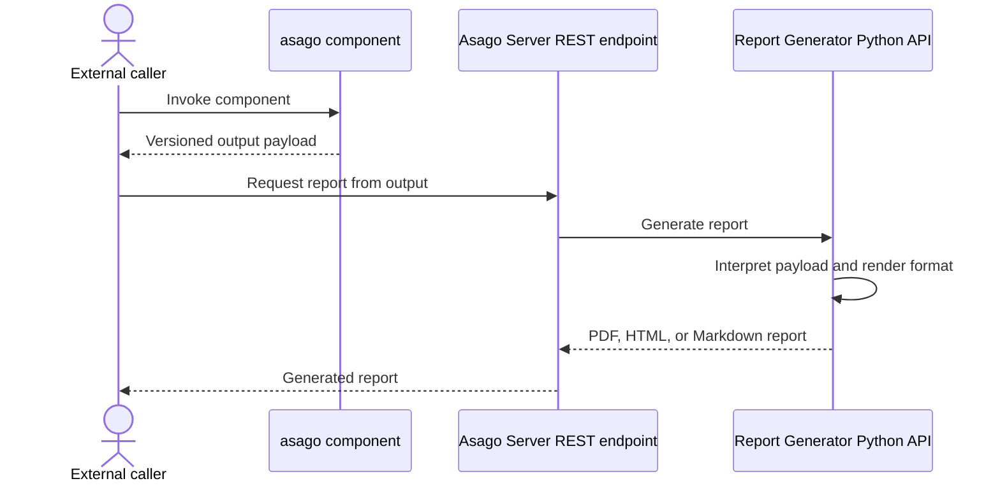

# asago - Architecture Decision Record for reporting

|                |            |
| -------------- | ---------- |
| Date           | 12th October 2026 |
| Scope          | Reporting for asago component outputs |
| Status         | DRAFT |
| Authors        | [Stuart Battersby](@blastStu) |
| Supersedes     | N/A |
| Superseded by: | N/A |
| Tickets        | |
| Other docs:    | [ASAGO-ADR-0001: Asago Server (PR)](https://github.com/asago-ai/architecture-decision-records/blob/dd8f56fe342f3fd00851cfcc2b6af723cba31c19/architecture-decision-records/ASAGO-ADR-0001-asago-server.md) |

## What

This ADR defines a separate, component-aware Report Generator that interprets versioned payloads from the asago components and produces PDF, HTML, or Markdown reports through an endpoint in the Asago Server REST API.

## Why

Report generation changes component outputs from their native payload format into report formats such as PDF, HTML, or Markdown. It is a format translation rather than a core component responsibility, so it should not sit inside the individual components. Centralizing it gives callers one reporting API, while component-specific logic lets the generator understand the meaning and structure of each component's payload.

This ADR requires ADR 0001 to be approved. It relies on the Asago Server exposing stateless components through a versioned REST API, while callers own orchestration and persistence.

## Goals

* Provide a separate Report Generator component, released as a versioned Python package.
* Interpret Policy Mapper, Scenario Generator, and Artifact Generator payloads using component-specific logic.
* Generate reports from those payloads in PDF, HTML, or Markdown.
* Make HTML output conform to PatternFly and support replaceable presentation templates.
* Let the caller select the output format for each report request.
* Expose report generation through the Asago Server REST API.
* Keep the Report Generator stateless through both its Python API and the Asago Server endpoint; retain no request or report data after returning a result.
* Validate input contract versions before generating a report and publish the payload schema versions supported by each Report Generator release.

## Non-Goals

* Orchestrating calls to the Policy Mapper, Scenario Generator, or Artifact Generator. The caller owns orchestration.
* Running evaluations, including EvalHub evaluations.
* Persisting input payloads or generated reports. The external calling application owns storage.
* Rendering arbitrary JSON without a supported component-specific handler; the generator is not a generic JSON-to-report converter.
* Defining the detailed report content or a particular branded template in this ADR.
* Defining endpoint and schema documentation in this ADR.

## How

The caller invokes the Python API directly or sends the required, versioned component output data to the Asago Server endpoint, selecting PDF, HTML, or Markdown for the output. For each input, the generator identifies the producing component and payload schema version, then dispatches it to logic that understands that component's payload structure and semantics. It uses the interpreted data to produce the requested format; it does not treat the payload as arbitrary JSON.

The exact request shape remains open and should align with the versioned contracts defined in ADR 0001.

### Example internal design

One possible implementation is for component-specific handlers to map validated payloads into a shared internal report content representation. For example, that representation could contain report metadata, sections, paragraphs, data tables, metric lists, and callouts. Format-specific renderers could then consume that representation to produce HTML, Markdown, or PDF. This separates payload interpretation from presentation and can avoid duplicating component-specific logic for each output format. A PDF renderer could produce output directly from the shared representation or use a deterministic rendering path based on the HTML output.

This internal design is an example rather than a requirement. The Report Generator may use a different internal structure or rendering approach, provided it still uses component-specific logic to interpret supported payloads and produces the selected output format.

### Report API

The Report Generator accepts versioned component output data and a requested output format: PDF, HTML, or Markdown. The input identifies the producing component, envelope version, and payload schema version. A component-specific handler interprets each supported payload schema and maps its data into report content. The API returns the report in the selected format. Detailed request and response schemas belong in API documentation.

### Stateless execution and data handling

Both the Python API and the Asago Server REST endpoint process each request without retaining state between calls. The generator may use input data while producing a report, but after returning the result it retains no request payload, generated report, or per-request state. It does not persist this data in files, caches, databases, object stores, or logs. The external calling application is responsible for storing any inputs or results it needs to keep.

### HTML technical standard and templates

HTML reports conform to the PatternFly design system. After component-specific handlers map payloads into report content, the HTML renderer applies a lightweight presentation template for styling and layout. Templates are external runtime assets, separate from the generator code, so a template can be applied or replaced without modifying or rebuilding that code. Changing a template affects presentation; it does not change how component payloads are interpreted or which payload schema versions are supported.

The template selection mechanism and template format are implementation details to document with the API and deployment configuration.

### Payload compatibility

Each Report Generator release declares the payload schema versions it supports for each component. Compatibility is based on the payload schema version, not only on the producing component's package release. The compatibility matrix is published with the Report Generator release and in the API documentation. If a request includes outputs from multiple components, each payload must use a schema version supported for that component by the Report Generator release in use. Unsupported component or schema versions are rejected with an appropriate 4xx response and a reason.

| Report Generator release | Envelope versions | Policy Mapper payload schema versions | Scenario Generator payload schema versions | Artifact Generator payload schema versions |
| ------------------------- | ----------------- | ------------------------------------- | ----------------------------------------- | ---------------------------------------- |
| TBD                       | TBD               | TBD                                   | TBD                                       | TBD                                      |

### Versioning and release

The Report Generator is released as a versioned Python package and included as a dependency of the Asago Server. The server has its own versioned release and associated image, as described in ADR 0001.

## Open Questions

* Should the endpoint accept separate component envelopes, a single combined report input, or both? In particular, should the Report Generator create reports for one component at a time, or a global asago report that combines outputs from multiple components?
* How should a request specify its desired output format?
* Should the API return the selected format inline or as a downloadable attachment?
* Should one request produce one format, or can it request multiple formats at once?
* How are HTML templates selected or applied: through deployment configuration or per request?
* Which PatternFly major version should templates target, and which lightweight template format should be supported?
* Should templates affect PDF or Markdown output as well as HTML?

## Alternatives

* Keep report generation within each component. This avoids introducing another package and endpoint, but is rejected because it does not provide a clean separation of concerns between a component's function and the translation of its output into report formats.
* Have the external caller generate reports. This avoids adding reporting behavior to the server, but is rejected because reporting is a core purpose of asago rather than a responsibility to duplicate across callers.
* Convert arbitrary JSON to a report without component-specific interpretation. This is rejected because the Report Generator is asago-specific and tied to supported component payload versions, not a general JSON-to-report maker.

## Security and Privacy Considerations

Component outputs and generated reports may contain confidential data. The Report Generator API and its deployment must follow the access control and data protection requirements for the Asago Server. Request and report content must not be written to logs or persistent storage by the generator. Generated HTML and Markdown must safely handle content from component outputs; PDF generation must not execute untrusted content or fetch unintended external resources. Runtime templates must be treated as trusted presentation assets and must not bypass output escaping or expose report data.

## Risks

* Component output contract changes can make existing report generation incompatible until the Report Generator supports the new payload schema versions, and each newly supported version requires component-specific interpretation logic and a compatibility matrix update. Align Report Generator releases with component contract releases so support remains up to date.
* Because the generator retains no results, callers must store reports and any component outputs needed for later use. This is an intentional separation of concerns rather than a defect: persistence and tracking currently belong to the external caller, and asago may later provide a separate component for that responsibility, potentially using a system such as MLflow.
* PDF, HTML, and Markdown renderers may produce different layouts or support different presentation features. This is expected because they are different formats; the important constraint is that each renderer preserves the key semantics of the report content.

## Stakeholder Impacts

| Group             | Key Contacts     | Date | Impacted? |
| ----------------- | ---------------- | ---- | --------- |
| Policy Mapper     | TBD              | TBD  | Yes: remove existing reporting and move it to the Report Generator |
| Scenario Generator | TBD              | TBD  | Yes: remove existing reporting and move it to the Report Generator |
| Artifact Generator | TBD              | TBD  | Yes: remove existing reporting and move it to the Report Generator |
| Asago Server      | TBD              | TBD  | Yes: add an API endpoint for the Report Generator |

## References

* [ASAGO-ADR-0001: Asago Server (PR)](https://github.com/asago-ai/architecture-decision-records/blob/dd8f56fe342f3fd00851cfcc2b6af723cba31c19/architecture-decision-records/ASAGO-ADR-0001-asago-server.md)
* [PatternFly](https://www.patternfly.org/)

## Reviews

| Reviewed by | Date | Notes |
| ----------- | ---- | ----- |
| TBD         | TBD  | Draft |
